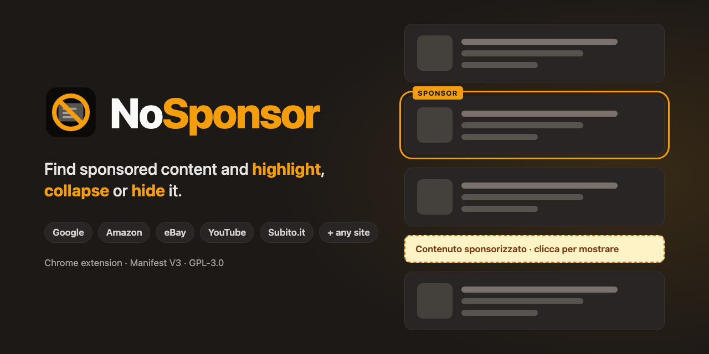
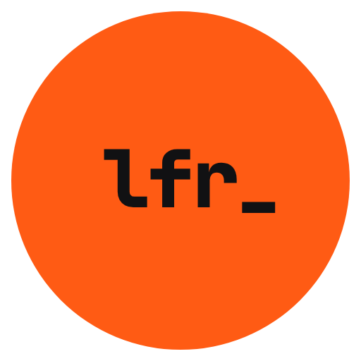

# NoSponsor



Chrome extension (Manifest V3) that finds sponsored content and **highlights** it, **collapses** it into a clickable bar, or **hides** it.

Dedicated detectors: **Google, Amazon, Subito.it, eBay**. On other sites there is a generic detection (can be turned off) based on the labels "Sponsorizzato", "Sponsored", "Pubblicità"... and on standard ad slots (Google Publisher Tag, AdSense).

On **YouTube**, video ads play at **16x**, so a 30-second ad is over in about 2 seconds. Meanwhile the picture is blacked out, the sound is muted and a label on the player shows the real time left. When the ad ends, the video goes on at the speed and with the sound it had before.

The UI is in Italian or English, following the browser's language (English for every other language). The project documentation lives in the owner's vault, outside the repo.

## Requirements

Node 22 (version in `.nvmrc`): with nvm, `nvm use` is enough.

## Development

```
npm install     # also runs `wxt prepare`, required by `npm run typecheck`
npm run dev     # opens Chrome with the extension loaded, with automatic reload
```

## Build and load in Chrome

```
npm run build
```

Then in `chrome://extensions` turn on **Developer mode**, click **Load unpacked** and choose `.output/chrome-mv3`. Reload the tabs that are already open.

## Scripts

| Script | What it does |
|---|---|
| `npm run dev` | Chrome with the extension, automatic reload |
| `npm run build` | Build into `.output/chrome-mv3` |
| `npm run zip` | Zip of the build in `.output/` |
| `npm run lint` | ESLint |
| `npm run typecheck` | `tsc --noEmit` |
| `npm run format` | Prettier |
| `npm test` | Unit tests (Vitest) |
| `npm run test:e2e` | Build and e2e tests (Playwright) |
| `npm run test:e2e:legacy` | The same e2e tests against 0.1.0 (needs the local tag `v0.1.0`) |
| `npm run snapshot` | Saves a real page as a fixture |
| `npm run record-expected` | Records the expected results of a fixture from 0.1.0 (needs the local tag `v0.1.0`); with `--build`, from the current build |

## Structure of `src/`

```
entrypoints/
  background.ts      per-tab counter on the icon
  content/           content script (index.ts) and the three modes (style.css)
  popup/             mode, per-site activation, generic detection
engine/              scanning, marking, containers, text and visibility
rules/               detectors.ts: per-site rules, almost all maintenance happens here
shared/              shared settings and messages
```

## Tests

- **Unit** (`tests/unit`, `npm test`): engine and rules, in happy-dom.
- **E2e** (`tests/e2e`, `npm run test:e2e`): Chromium with the built extension, on real pages saved in `tests/fixtures/<site>/<page>.html`. Next to each one there is `<page>.expected.json`, the result recorded from 0.1.0: the build must produce an identical one. `npm run test:e2e:legacy` runs the same tests against 0.1.0.
- `test:e2e:legacy` and `record-expected` read 0.1.0 from the local tag `v0.1.0`: create it with `git tag v0.1.0 57dc693` (or `git fetch --tags`, once the tag is published).
- The expected results were recorded on **macOS** and depend on fonts and layout (`nsp-inset`, visibility on sites that obfuscate): on Linux they may not match. That is why CI runs on `macos-latest`.

### Adding or redoing a saved page

```
npm run snapshot -- <site> <page> <url> [--manual]
npm run record-expected -- <site>/<page>
```

`snapshot` saves the cleaned-up page (no scripts or images) in `tests/fixtures/<site>/`. With `--manual` the browser opens with a fresh profile and you prepare the page by hand (captcha, cookies, scrolling until the sponsored blocks load) before saving; never log in. If the site blocks Playwright's Chromium, use `NSP_CHANNEL=chrome` for the installed Chrome. `record-expected` records the expected results, to be checked by hand before the commit.

The expected results describe what 0.1.0 does, unless the behaviour was changed on purpose: then run `npm run build` and `npm run record-expected -- --build <site>/<page>`, which records the current build and writes `"since": "<version>"` in the file. `test:e2e:legacy` skips those pages. A page may also be hand-written when the real one cannot be saved without personal data (`amazon/home-personalizzata`, reduced from a logged-in home: `"handWritten": true` in its `.meta.json`).

The repository is public, so a saved page must not contain personal data. The script replaces Amazon's delivery location and Google's IP-based postcode, and prints any address-like strings left (for example Google's local results, which follow your location): neutralize them by hand before committing.

## How it works

- The content script **does not remove nodes**: it adds the `.nsp-hit` class and the CSS does the rest based on `<html data-nsp-mode="highlight|collapse|hide|off">`. This way React/Vue don't break and switching mode is instant.
- Three strategies per site: **known selectors**, **text labels** (going up to the card's container) and, on sites that obfuscate, the **actually visible text** rebuilt in on-screen order (letters hidden via CSS or reordered with `order`) plus `aria-labelledby`.
- A debounced `MutationObserver` covers infinite scroll and content loaded later.
- Every marked element has `data-nsp-reason` with the rule that found it: useful in DevTools to understand false positives.
- UI texts live in `public/_locales/{en,it}/messages.json` and are read through `t()` in `src/shared/i18n.ts`. The texts the CSS shows on pages (collapsed bar, YouTube ad veil) are passed as custom properties on `<html>`, with English as the fallback in the stylesheet. The e2e tests run in Italian unless a test asks for another language (`launch('en')`).

## Quick debugging

In DevTools on a page:

```js
[...document.querySelectorAll('.nsp-hit')].map(e => e.dataset.nspReason)
```

## Notes

- On Subito "annuncio" is the ordinary word for a listing, so it is not among the labels; "Vetrina" and "In evidenza" (paid promotions) are.
- Site selectors change over time: if something stops working, inspect the card and update `src/rules/detectors.ts`.

## License

GPL-3.0-or-later (see `LICENSE`).

---

<p align="center">
  Made by&nbsp;
  <a href="https://leicaflorianrobert.dev"></a>
  &nbsp;<a href="https://leicaflorianrobert.dev">Leica Florian Robert</a>
</p>
